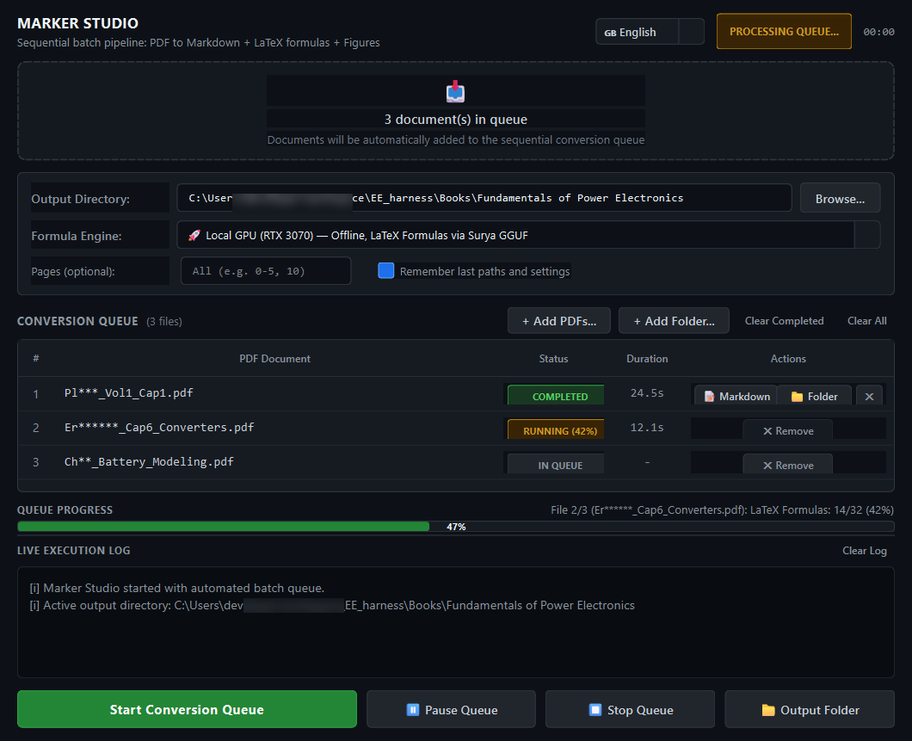
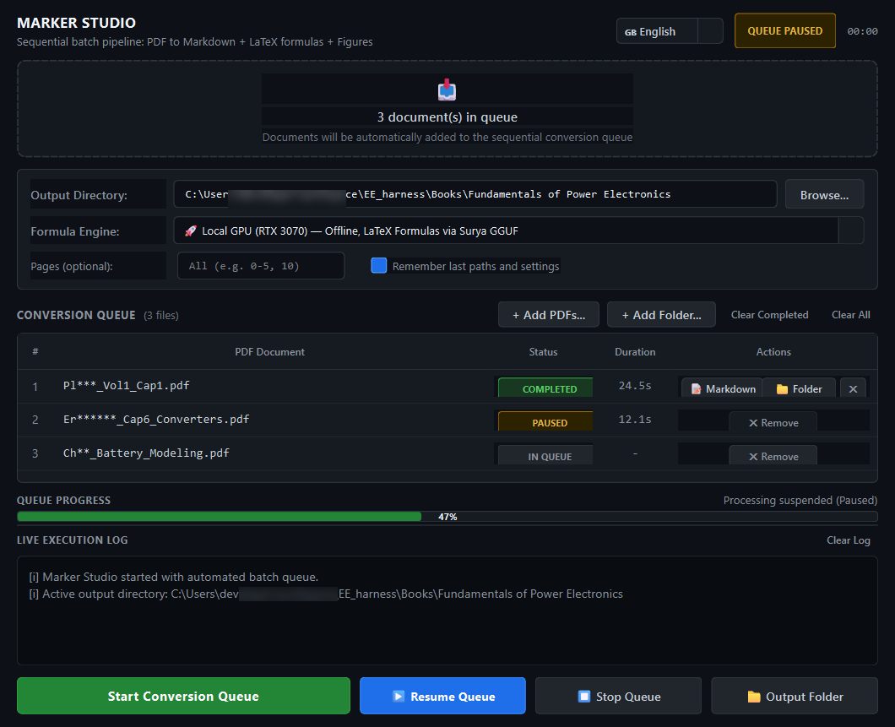

# Marker Studio

[](https://www.python.org/)
[](https://pypi.org/project/PyQt6/)
[](LICENSE)
[]()

**Marker Studio** is a clean, native desktop application and batch conversion queue for [marker-pdf](https://github.com/VikParuchuri/marker). It converts complex technical PDFs, academic textbooks, and scientific papers into structured Markdown notes with accurate LaTeX mathematical formulas (`$$...$$` & `$...$`) and extracted figures.

Designed with a quiet, distraction-free dark utilitarian aesthetic (inspired by GitHub UI), Marker Studio handles sequential multi-document workloads without manual terminal intervention.

---

## 📸 Screenshots



*Marker Studio executing a sequential batch conversion queue with real-time stage progress and English interface.*



*Instant low-level process suspension (Pause / Resume) without data loss.*

---

## ✨ Key Features

- **Sequential Batch Conversion Queue**:
  - Drag & drop multiple PDF files or entire folder trees directly into the UI.
  - Automatic FIFO execution — converts one document after another without memory exhaustion.
  - Per-item duration timers and status badges (`QUEUED`, `RUNNING`, `PAUSED`, `COMPLETED`, `ERROR`).
  - Batch **"Clear Completed"** button and inline single-item dismissal (`✕`).
  - Direct quick-open buttons: `[ 📝 Markdown ]` and `[ 📁 Folder ]`.

- **3 Formula Recognition Engines**:
  1. **🚀 Local GPU (RTX / CUDA)**: 100% offline and privacy-first. Combines Marker's fast digital text extraction with local Surya-2 GGUF vision inference via `llama-server.exe` to convert numbered and inline equations into pure LaTeX in seconds.
  2. **☁️ Cloud AI (Gemini Flash)**: Leverages Google AI Studio (`gemini-2.5-flash`) for difficult or degraded formulas.
  3. **⚡ Fast Text-Only (`--disable_ocr`)**: High-speed digital text extraction for non-mathematical documents and novels.

- **⏸️ Live Process Pause & Resume**:
  - Uses OS-level process tree suspension (`psutil`) on Windows.
  - Instantly pauses `marker_single.exe`, Python, and the local `llama-server.exe` subprocesses without corrupting files or losing progress.
  - Resume with a single click right where it left off.

- **📊 Dual-Stage Real-Time Progress Bar**:
  - Parses intra-file stage progress (Page Layout, OCR, LaTeX Formulas, Tables) directly from CLI output streams.
  - Displays dynamic intra-file stage percentage alongside weighted overall queue progress.

- **🌐 Bilingual Interface**:
  - **English (Default)** and **Italiano**.
  - Switch languages dynamically at runtime via the top-bar selector with instant UI re-rendering.

- **🎨 Utilitarian Dark UI & Windows Integration**:
  - High-contrast, clean dark theme (`#0d1117`).
  - Native Windows taskbar pinning support (`SetCurrentProcessExplicitAppUserModelID`).
  - Lightweight C# native launcher (`MarkerStudio.exe`) with embedded application icon.

---

## 🛠️ Installation & Setup

### 1. Prerequisites
- **Python**: Version 3.10, 3.11, or 3.12 (64-bit).
- **GPU (Recommended)**: NVIDIA GPU with CUDA drivers installed (for local offline acceleration). Marker Studio will also run on CPU or Cloud mode.

### 2. Clone the Repository
```bash
git clone https://github.com/Denys/marker_gui.git
cd marker_gui
```

### 3. Create Virtual Environment & Install Dependencies
```bash
# Create virtual environment
python -m venv .venv

# Activate on Windows (PowerShell)
.\.venv\Scripts\Activate.ps1

# Install core dependencies
pip install --upgrade pip
pip install -r requirements.txt
```

> **Note on PyTorch & CUDA**: To enable GPU acceleration for local OCR and PyTorch, install the matching PyTorch CUDA build:
> ```bash
> pip install torch torchvision --index-url https://download.pytorch.org/whl/cu121
> ```

---

## 🚀 Running Marker Studio

You can launch Marker Studio using any of the following methods:

### Option A: Via Python (Cross-platform)
```bash
python marker_gui_app.py
```

### Option B: Via Native Windows Launcher (`MarkerStudio.exe`)
Double-click `MarkerStudio.exe` located in the root folder. You can also:
- Pin it directly to your Windows Taskbar or Start Menu.
- Drag and drop PDF files onto `MarkerStudio.exe` to launch directly with queued files.

### Option C: Via Batch / VBScript
- `launch_gui.bat`: Runs with a console window (useful for debugging).
- `launch_gui_silent.vbs`: Runs silently without a terminal window.

---

## 🧮 Local GPU Formula Engine Setup (Optional)

For the **Local GPU (RTX 3070)** engine, Marker uses `llama-server.exe` to run the Surya formula vision model in GGUF format:

1. Download a prebuilt `llama.cpp` Windows CUDA release (e.g. `llama-bXXXX-bin-win-cuda-cu12.X-x64.zip`) from [llama.cpp releases](https://github.com/ggerganov/llama.cpp/releases).
2. Extract the contents (`llama-server.exe`, `ggml-cuda.dll`, etc.) into a `bin/` folder inside this directory:
   ```
   marker_gui/
   ├── bin/
   │   ├── llama-server.exe
   │   ├── ggml-cuda.dll
   │   └── ...
   ```
3. Marker Studio will automatically detect `bin/llama-server.exe` and route formula OCR through local GPU tensor cores.

---

## 📂 Project Structure

```
marker_gui/
├── marker_gui_app.py        # Core PyQt6 application with queue engine & bilingual i18n
├── MarkerStudio.cs          # Native C# launcher source code
├── MarkerStudio.exe         # Compiled lightweight standalone launcher
├── app_icon.ico             # High-res application icon
├── launch_gui.bat           # Convenience launcher script
├── launch_gui_silent.vbs    # Background launcher script
├── requirements.txt         # Python package dependencies
├── README.md                # Documentation & instructions
├── LICENSE                  # MIT License
└── docs/
    └── screenshots/         # UI preview images
```

---

## ⚙️ Configuration

Marker Studio automatically persists user preferences in a local `config.json`:
- `language`: `"en"` (default) or `"it"`
- `last_output_dir`: Last destination directory used
- `last_input_dir`: Last browsed PDF folder
- `engine_mode`: `"local_gpu"`, `"gemini_cloud"`, or `"fast_text"`

---

## 📄 License & Acknowledgements

- **License**: Released under the [MIT License](LICENSE).
- **Core Engine**: Powered by [marker-pdf](https://github.com/VikParuchuri/marker) and [Surya](https://github.com/VikParuchuri/surya) by Vik Paruchuri / Datalab.
